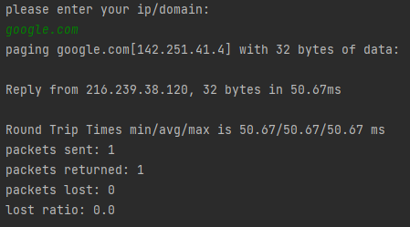
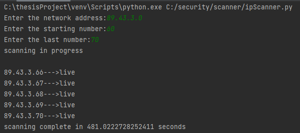
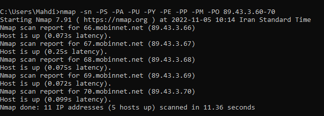
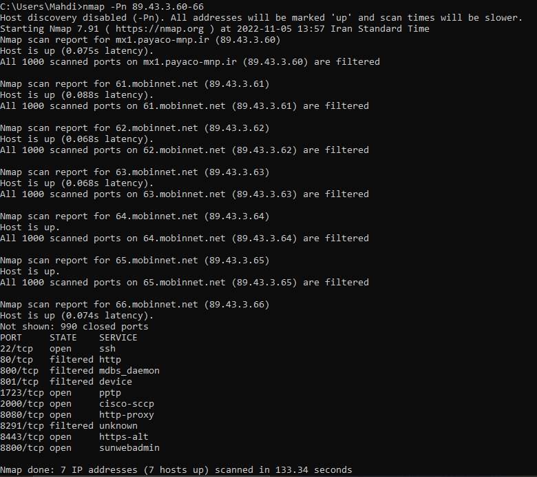
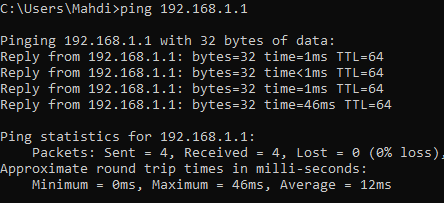
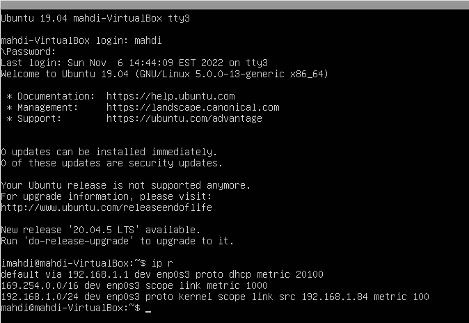
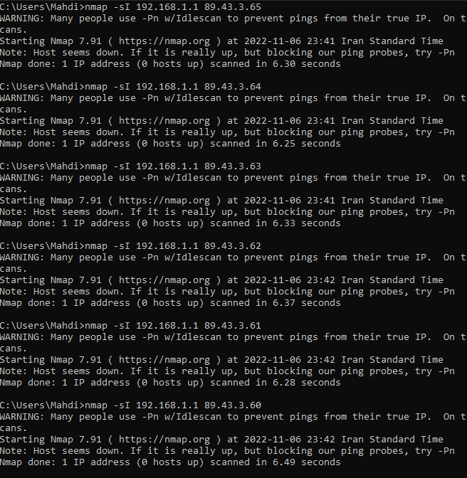
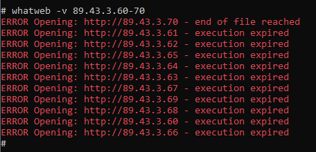
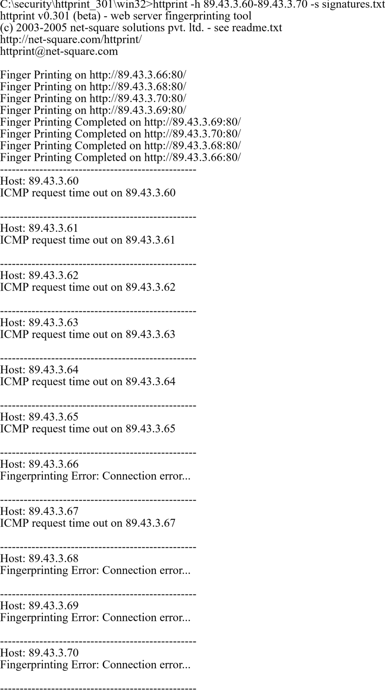
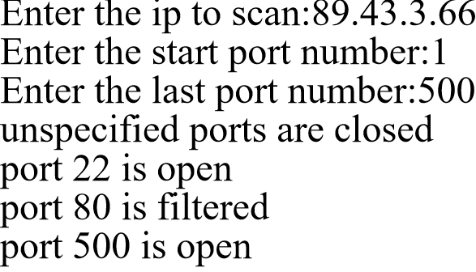

# scanner
The output of the each code will be stored in a file named result_[ActionName].txt. 
For example, the Python code file related to the ping part of the project should be named ping.py and its output should be in the format result_ping.txt.

In the host scanner we scan a host to find it's open ports via the help of nmap library.
In the ip scanner we 
Getting a ping from a specific IP
• Scan an IP range and find active hosts
• Scan the open ports of an active host
The ping part should work with both IP and domain name and its output is as follows:
The output of scanning the IP range and finding active hosts:
Output of open ports scan of active hosts:

# Ping implementation

To implement ping, we use the pythonping library, whose translation for the google.com domain can be seen below:

# Implementation of IP range scanner

To implement it, we use the nmap library. First we use all kinds of probe packages to get a response from the active hosts, and if we don't receive responses from the hosts, we use the Pn mode to see if the famous service ports such as http and... on
these hosts are open or closed, and if they are open, we assume the related services are active.
The output of scanner can be seen below

We use nmap, whatsweb, netdiscover, httprint and xprobe2 to test the correctness of the scanner.

nmap output:

As you can see, the output of nmap is the same as the output of our program, and by using Fingerprint scan, we can guess the operating system of some of these hosts with a good probability.

Now, using a vm as a zombie host and Idle scan, we recheck the hosts that seemed to be inactive, The steps of which can be seen in the following photos:

As it can be seen, using idle scan, these hosts also appear to be inactive.

# Netdiscover output 

Unfortunately, netdiscover is unable to detect the status of any of the hosts because it uses the ARP protocol and none of these
servers respond to the arp protocol.

# Whatweb output 

Note that whatweb software is more for checking specific websites like reddit.com and... and not hosts that are only used as servers, therefore it's not that usefull for our usage, as it can seen below:

# Httprint 

Considering that the httprint software is mostly for specific websites, using it we can only see which hosts are active (of course, the x.x.x.67 host is also active, but httprint has shown it to be inactive), therefore we can't get alot of information when using them for regular servers. The xprobe2 output is in the xprobe.png file. As seen in the output, xprobe2's guesses about servers' operating systems are unclear, and it also fails to guess about server x.x.x.70. While with nmap we could guess the operating system with a good probability.

# Port scanner implementation

We also use the nmap library to implement the port scanner. We use all kinds of scans (apart from the scans that require parameters such as idle scan or ftp bounce scan) to see which ports are active. The output of the scanner can be seen below:

We also use hping3 to test the correctness of the scanner, as can be seen below:

According to hprint3 output, all ports are closed. While with the scanner (in which we use nmap) we can see that 22 and 500 are open and port 80 may also be open.

